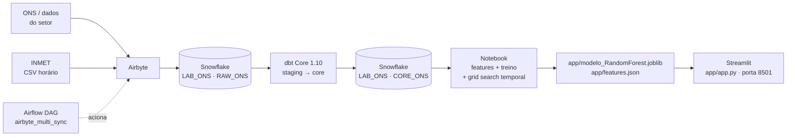

# ONS Energy Deficit Risk

Classificação de risco de déficit energético para o **subsistema SE** do setor elétrico
brasileiro (ONS — Operador Nacional do Sistema Elétrico), combinando modelagem de dados
com dbt Core sobre Snowflake e um modelo de Machine Learning servido em Streamlit.

[](https://github.com/israelmteixeira1/ons-energy-deficit-risk/actions/workflows/dbt-ci.yml)
[](LICENSE)

---

## Problem

Balanço de energia do Sistema Elétrico Nacional é definido por uma rede de hidrelias,
termelegas, eólicas e solares cuyo déficit é função simultânea de:

- **demanda** (carga diária),
- **disponibilidade de geração** (fator de capacidade, geradores térmicos),
- **intercâmbio** entre subsistemas (o gargalo estrutural do SE),
- **armazenamento** (energia armazenável e risco hídrico),
- **clima** (precipitação, temperatura, umidade, vento).

Este projeto é uma demonstração de **indicador experimental e não oficial** de regime
de intercâmbio, com três faixas — *Baixo*, *Medio*, *Alto*. Não estima déficit físico,
não reproduz classificação oficial do ONS e não deve orientar despacho, comunicação
operacional ou outras decisões. Features com sufixo D-1 são defasadas; isso, por si só,
não comprova disponibilidade dos dados no instante da previsão.

## Data

| Fonte | Conteúdo | Destino |
|---|---|---|
| ONS | Balanço de energia, EAR/ENA diários, disponibilidade de usinas, geração térmica despachada, fator de capacidade, restrição fotovoltaica | Snowflake `LAB_ONS.RAW_ONS` → `LAB_ONS.CORE_ONS` |
| INMET | Precipitação, temperatura, umidade, vento (CSV horário) | S3 `csvclima01` (us-east-2) → `LAB_ONS.CORE_ONS` |

O pipeline dbt tem **21 modelos** (13 em `core/`, 8 em `staging/`), **33 testes de
dados** e **98 sources** declaradas.

```bash
dbt ls --resource-type model   # 21 modelos
dbt ls --resource-type test    # 33 testes
```

## Architecture



| Camada | Tecnologia | Onde |
|---|---|---|
| Ingestão | Airbyte (chamado por Airflow) | `dags/airbyte_multi_sync_dag.py` |
| Warehouse | Snowflake — `LAB_ONS` | — |
| Transformação | dbt Core 1.10.11 + dbt-snowflake 1.10.2 + dbt_utils 0.9.6 | `models/`, `macros/`, `tests/` |
| ML | scikit-learn 1.2.2 (RandomForest) | `notebook/notebook.ipynb` |
| Serving | Streamlit 1.35.0 | `app/app.py` |

## ML Model

**Ficha completa: [`MODEL_CARD.md`](MODEL_CARD.md)** — dados, features, métricas,
limitações e reprodutibilidade.

- **Algoritmo:** `RandomForestClassifier` — `n_estimators=600`, `max_depth=8`,
  `min_samples_leaf=5`, `max_features="sqrt"`, `random_state=42`
- **Saída:** 3 classes — `Baixo = 0`, `Medio = 1`, `Alto = 2`
- **Features:** 34 (lags de sistema, clima, calendário e flags), **em ordem posicional** —
  a ordem faz parte do contrato do artefato
- **Métricas (alegações históricas do notebook, não re-verificadas aqui):**
  holdout **QWK 0.747 / ACC 0.831**; time-series CV **QWK 0.593 ± 0.141**

### Top-5 importâncias (impureza, extraídas do artefato publicado)

| # | Feature | Importância |
|---|---|---|
| 1 | `INTERCAMBIO_MW_MEDIO_DIA_d-1` | 0.1482 |
| 2 | `IMPORT_RATIO_d-1` | 0.1333 |
| 3 | `INTERCAMBIO_MW_MEDIO_DIA_7d` | 0.0659 |
| 4 | `STRESS_HIDRICO` | 0.0471 |
| 5 | `INTERCAMBIO_MW_MEDIO_DIA_min_7d` | 0.0441 |

As importâncias de impureza não demonstram causalidade nem validam o indicador como
risco de déficit. O alvo foi criado a partir do próprio intercâmbio.

> ⚠️ O artefato é **travado em scikit-learn 1.2.2**: a partir do 1.3 a carga do
> `.joblib` falha por mudança no layout do nó da árvore. Use o pins de
> `app/requirements.txt` (Python 3.11).

## Quickstart

```bash
# build da imagem (a partir da raiz do repo)
docker build -t ons-energy-deficit-risk .

# sobe o app em http://localhost:8501
docker run --rm -p 8501:8501 ons-energy-deficit-risk
```

O contêiner sobe apenas o app Streamlit (o `dbt` roda no CI e contra o Snowflake).

## Local dev

### App (Streamlit)

```bash
python3.11 -m venv .venv
source .venv/bin/activate
pip install -r app/requirements.txt

cd app            # o app resolve features.json / modelo / CSV a partir do CWD
streamlit run app.py
```

O padrão é `df_demo.csv`, uma amostra histórica — não são dados atuais. Para outra
entrada, defina `DEMO_CSV=/caminho/arquivo.csv` antes de iniciar; `FEATURES_JSON` e
`MODEL_PATH` também podem ser definidos. O CSV deve conter `DATA_REFERENCIA`, `DATA`
ou `DATE`, datas válidas em todas as linhas e `NOM_SUBSISTEMA` igual a
`SUDESTE/CENTRO-OESTE` em todas as linhas (ignorando caixa e espaços externos).
As 34 colunas de features já calculadas são obrigatórias; na linha de data mais
recente, todos os valores devem ser numéricos e finitos para permitir a inferência.
Ausências ou valores inválidos nessa linha causam erro, não são substituídos por zeros.
Quando SHAP está disponível e o indicador é calculado, as até 1.000 linhas mais recentes
também são verificadas: se alguma feature nesse contexto for inválida, o app mantém a
inferência e exibe aviso, sem calcular SHAP. Linhas anteriores a esse contexto não têm
os valores de features validados. SHAP também pode estar indisponível por outros erros.
O app não constrói features nem verifica a disponibilidade histórica das fontes.

O modelo e o manifesto de features são mantidos em cache pelo Streamlit, por caminho;
substituir arquivos no mesmo caminho não invalida esses caches. Pare todas as instâncias
do app, substitua modelo e manifesto como um conjunto compatível e reinicie todas as
instâncias antes de voltar a servir requisições. A inferência exige `classes_` exatamente
`[0, 1, 2]`, nessa ordem; outros modelos são rejeitados.

Testes locais sem credenciais (incluem inferência do artefato e UI):

```bash
pip install pytest==8.3.5
python -m pytest -q tests
```

### dbt

Use um ambiente separado do app: as dependências transitivas de dbt/Snowflake e
Streamlit podem entrar em conflito (por exemplo, `protobuf`).

```bash
python3.11 -m venv .venv-dbt && source .venv-dbt/bin/activate
pip install dbt-core==1.10.11 dbt-snowflake==1.10.2

mkdir -p ~/.dbt
# Crie ~/.dbt/profiles.yml com o exemplo abaixo e configure as variáveis em ambiente seguro.
dbt deps
dbt debug        # testa a conexão
dbt run
dbt test
```

Exemplo de `~/.dbt/profiles.yml` (não versione credenciais):

```yaml
ons_ml:
  target: dev
  outputs:
    dev:
      type: snowflake
      account: "{{ env_var('SNOWFLAKE_ACCOUNT') }}"
      user: "{{ env_var('SNOWFLAKE_USER') }}"
      password: "{{ env_var('SNOWFLAKE_PASSWORD') }}"
      role: "{{ env_var('SNOWFLAKE_ROLE') }}"
      database: LAB_ONS
      warehouse: "{{ env_var('SNOWFLAKE_WAREHOUSE') }}"
      schema: STAGING_ONS
      threads: 1
```

A DAG limita cada pedido HTTP a 30 s e cada job a 360 consultas, separadas por 10 s;
isto não é prazo total de uma hora, pois o tempo das requisições se soma. Um timeout
não cancela o job remoto. Retries automáticos estão desativados, mas isso **não impede**
uma execução agendada posterior, manual, de outra DAG ou pelo próprio Airbyte de
sobrepor um job ainda ativo. Não há bloqueio distribuído nem reconciliação automática;
não use o agendamento sem supervisão enquanto essa garantia não existir.

Procedimento em falha, timeout, interrupção do worker ou estado remoto desconhecido:

1. Pause imediatamente a DAG no Airflow e desabilite outros disparadores das conexões
   envolvidas, inclusive agendamentos no Airbyte, durante a reconciliação. A pausa não
   cancela trabalhos já iniciados; evite triggers manuais e novos reruns.
2. Consulte no Airbyte os jobs de cada conexão, inclusive os das execuções anteriores.
   O log informa conexão e job quando o ID foi recebido. Um timeout na requisição inicial
   pode ter criado job sem retornar ID: nesse caso procure pelo histórico da conexão e
   horário. Sem conseguir confirmar o estado, mantenha tudo pausado e investigue.
3. Aguarde cada job ativo terminar ou cancele-o pelo Airbyte e confirme estado terminal;
   confirme também que não há execuções do Airflow em andamento. Avalie o que já foi
   sincronizado antes de reexecutar: um rerun reinicia a lista desde a primeira conexão.
4. Só após reconciliação e garantia operacional de exclusão de outros disparadores,
   reexecute e, quando seguro, reative o agendamento. Ausência dessa coordenação mantém
   risco de sobreposição, inclusive após falhas futuras.

O cron `0 0 */2 * *` reinicia no mês e não garante intervalos fixos de 48 horas.

Comandos úteis: `dbt run --select staging.*`, `dbt run --select nome_do_modelo`,
`dbt clean`.

### CI

`.github/workflows/dbt-ci.yml` roda a cada PR: `dbt deps` → `dbt parse` → `dbt ls`
(com verificação de que os 8 modelos de staging resolvem para os nomes snake_case
corretos). `dbt compile` e `dbt test` exigem conexão viva com o Snowflake e **não**
rodam no CI de pull request.

## Limitations

- **Um único subsistema.** Treinado e avaliado só no SUDESTE — não há evidência de
  generalização para os demais.
- **Base pequena.** 579 observações diárias para 34 features e 3 classes: variância alta,
  apesar do grid search temporal.
- **Alvo autorregulado.** O ground truth é o quantil do intercâmbio, não a classificação
  oficial do ONS.
- **Sem monitoramento de concept drift.** Nada detecta mudança de regime ou retreina o
  modelo.
- **Métricas são alegações do autor.** Os números de holdout e TS-CV vêm das saídas do
  notebook de 2025-10-17; não foram reexecutados neste repositório (o retreinamento exige
  credenciais de Snowflake e S3).
- **Artefato versionado.** Ver [ML Model](#ml-model).
- **Testes de dados exigem credenciais.** `dbt test` só roda com acesso ao Snowflake.

## License

[MIT](LICENSE) — © 2025 israelmteixeira1.
